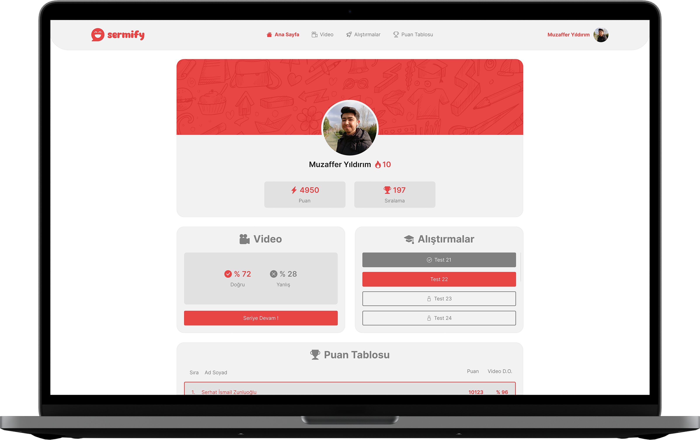

<div align="center">

# Sermify

**English learning and quiz platform** · graduation project, Necmettin Erbakan University (2024)



</div>

Learners work through levelled English tests and video questions, earn points and climb the leaderboard. Admins create and edit the content from a Laravel panel.

## Features

- **Levelled tests** with multiple choice and matching questions, unlocked step by step
- **Video questions** with optional time limits and accuracy tracking
- **Points, ranks and leaderboard**, plus accuracy-rate tests on the profile
- **Accounts:** email/password and Google sign-in, password reset, profile photo
- **Admin panel** to create, edit and organise tests, questions and media

## Structure

| Folder | What it is | Stack |
| --- | --- | --- |
| [`WebProjectQuiz/`](WebProjectQuiz) | Admin panel and REST API | Laravel 10, Jetstream + Livewire, Sanctum, JWT, Socialite, MySQL |
| [`english-app/`](english-app) | Learner-facing web app | React 18, Vite, React Router, Sass, Axios |

## Run locally

**Backend** (PHP 8.1+, Composer, MySQL)

```bash
cd WebProjectQuiz
composer install
cp .env.example .env        # then set your DB credentials
php artisan key:generate
php artisan jwt:secret
php artisan migrate --seed
php artisan serve           # http://localhost:8000
```

**Frontend** (Node 21, see `.nvmrc`)

```bash
cd english-app
npm install
# point VITE_API_URL and VITE_PROXY in .env.development at the backend, e.g. http://localhost:8000
npm run start-dev
```

## Team

Built by [Sema Ermin](https://github.com/semaermin) and [Serhat İsmail Zunluoğlu](https://github.com/serhatzunluoglu). I built the Laravel admin panel; we developed the React interface together.

The project is no longer hosted; this repository is kept as a portfolio piece.
